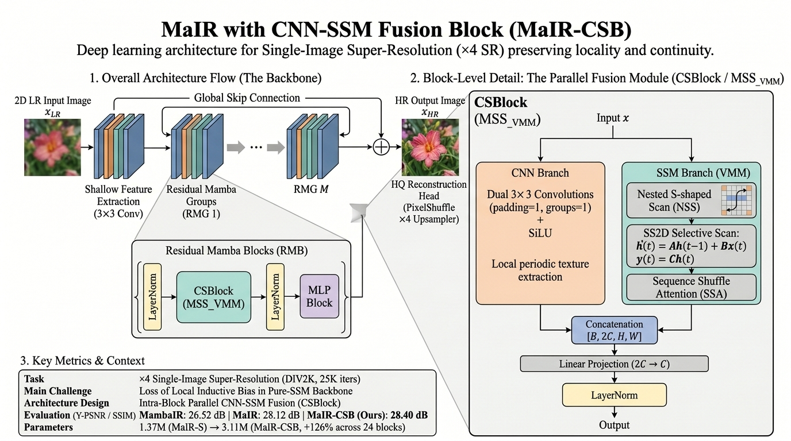
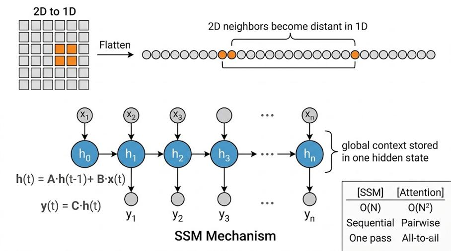
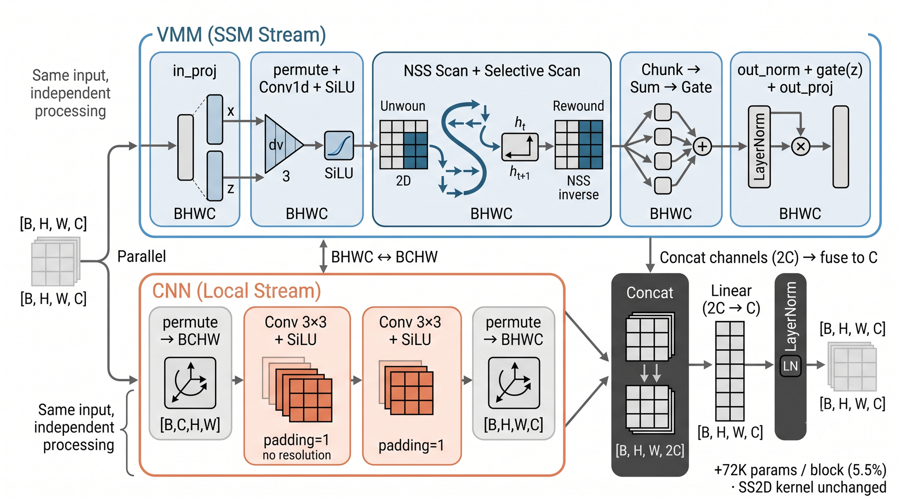
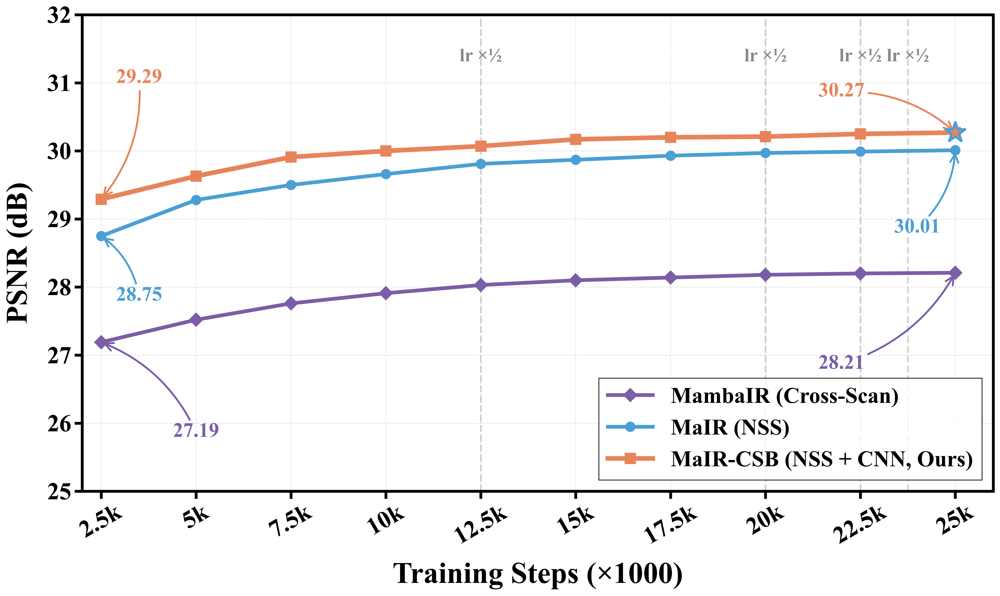
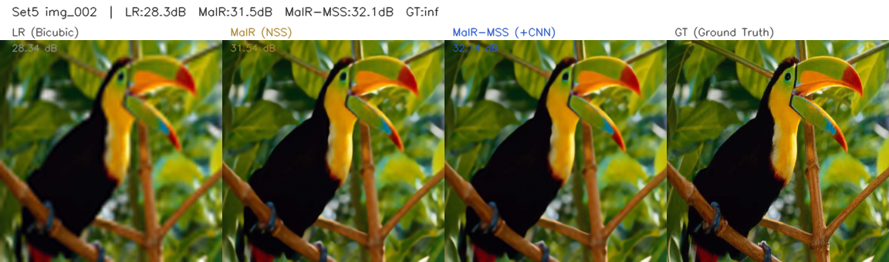
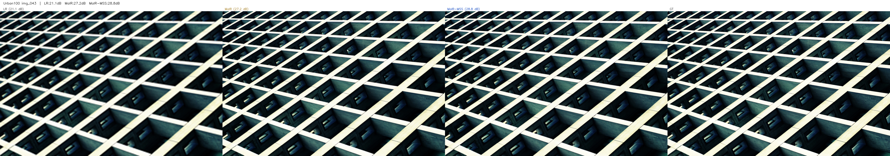

# State-Space Models for Image Super-Resolution

**Scan redundancy and the price of a local operator**

[English](README.md) | [中文](README.zh-CN.md)

> A two-stage course research project. Full reports: [`mambair/report.pdf`](mambair/report.pdf) (13 pages) and [`mair-cnn-ssm/report.pdf`](mair-cnn-ssm/report.pdf) (14 pages).

<p align="center">
  
  <br><em>The whole system in one figure. Left: the three-stage backbone, the internals of the residual block, and where CSBlock sits inside it. Right: CSBlock's two parallel streams (the CNN branch and the VMM branch) and how they are fused. Bottom left: the final numbers from both stages. Everything below is an expansion of this figure.</em>
</p>

---

## 1. Background

Single-image super-resolution reconstructs a high-resolution image from one low-resolution observation, and it is an ill-posed inverse problem: many HR images are consistent with the same LR input, so the job is not to invert anything but to *choose* — to learn a prior over natural image structure that picks the right one. Three families of sequence model have carried that prior. CNNs widen the receptive field by stacking depth, at the cost of reaching global relationships only indirectly. Transformers model the whole image with pairwise attention, at O(N²). State-space models — Mamba in particular — claim both: a selective recurrence that compresses the whole prefix into a hidden state, at O(N). MambaIR took that claim into image restoration by swapping SwinIR's attention blocks for VSSM, and MaIR pushed it further. The trouble is exactly where the claim is made: SSMs are defined on **1D sequences**, and an image is not one. Every Mamba-based restoration model therefore has to answer the same question — *how do you serialize a 2D image without destroying the 2D neighbourhood structure the convolution it replaced used to get for free* — and the answer each model gives is the thing that separates it from the others.

MambaIR's answer is to scan **four times** — along rows, columns, and both diagonals — and sum the four results element-wise. The bet is that four 1D orders, added up, approximate the 2D neighbourhood the convolution used to provide. Stage one of this repository tests that bet directly: on frozen weights, changing nothing but how many directions the forward pass sums, dropping from four scans to one costs **0.10 dB on average** across four benchmarks. Three of the four directions are echoes, not four independent views. The root cause is not hard to see once stated — 1D flattening has already destroyed 2D continuity *before* scanning begins. On a 64×64 feature map, vertically adjacent pixels sit 64 tokens apart in row-major order, and re-flattening in another order does not restore what was lost. MambaIR bought four scans and got one direction's worth of information.

With the diagnosis in hand the design principle follows: rather than compensating with more scan orders, put the local operator back directly. MaIR takes that route and answers the serialization question head-on — **NSS** (a nested S-shaped scan) replaces the four straight lines with a single path whose folds shrink the 1D distance between vertically adjacent pixels from *W* to **2**, preserving both directions of neighbourhood in one scan, while **SSA** replaces MambaIR's blind sum with a learnable channel gate. Under identical training conditions that is worth **+1.61 dB**, by a wide margin the largest effect measured here. But the price is visible in the architecture diagram: MaIR's residual block is `LayerNorm → VMM → LayerNorm → MLP`, and with CAB gone the deep feature path contains **no convolution at all**. A mechanism whose inductive bias is *global* is being asked to express local, high-frequency texture — which is the hypothesis **CSBlock** exists to test.

CSBlock runs the SSM stream and a convolutional stream **side by side inside one block**, both fed the block's original input, fused by channel concatenation and a linear projection. It gives **+0.27 dB on average, 4-of-4 wins, no regression anywhere**; Urban100 (+0.42, regular architecture and repeating structure) gains 3× what B100 (+0.13, natural stochastic texture) does — the ordering of the gains confirms the mechanism, not just the number. The cost is **+126% parameters**; the network more than doubles. As a paper-style contribution that is a poor trade. As a study of *where* a pure-SSM vision backbone is still weak, the signal is clear: local, periodic structure, addressable with a 3×3 receptive field.

<p align="center">
  
  <br><em>An SSM carries h(t) = A·h(t-1) + B·x(t) and emits y(t) = C·h(t): O(N), with the whole prefix compressed into one state. Flatten the grid, though, and vertical neighbours land far apart in the sequence (the orange pair), so the recurrence spends capacity representing that distance instead of the relationship.</em>
</p>

---

## 2. Key Features / Contributions

1. **A scan-direction ablation that isolates Cross-Scan's redundancy.** Inference-only, on frozen weights, changing nothing but how many directions `forward_core` sums. Dropping from four directions to one costs **0.10 dB on average** across Set5 / Set14 / B100 / Urban100. If the four scans were four independent views, a 75% reduction should hurt far more than that. It does not.

2. **A matched-budget reproduction of MambaIR and MaIR.** Both upstream models, run end to end under identical compute — MaIR beats MambaIR by **+1.61 dB**, the largest effect measured here, and converges far faster: 29 dB in ~4,000 iterations, which MambaIR does not reach in 25,000. That shared yardstick is what makes every comparison below meaningful.

3. **CSBlock — a CNN-SSM fusion module (46 lines).** A small CNN runs *in parallel with the VMM inside the same block*, reading the block's original input rather than the SSM output, so the local branch sees the unprocessed signal instead of trying to recover it afterwards. **+0.27 dB average, 4-of-4 wins, +0.42 dB on Urban100.**

4. **A corrected parameter accounting.** CSBlock's model-level cost is **+126%**, not a rounding error. It is called out separately because it decides how the module should be positioned: a diagnostic instrument, not a bargain.

Final results (×4, Y-channel PSNR / SSIM):

| Test set | MambaIR (repro) | MaIR (repro) | MaIR + CSBlock | MaIR (paper) | CSBlock gap to paper |
|---|:---:|:---:|:---:|:---:|:---:|
| Set5 | 29.29 / 0.837 | 31.64 / 0.886 | **31.98 / 0.891** | 32.48 / 0.899 | −0.50 |
| Set14 | 26.73 / 0.723 | 28.22 / 0.773 | **28.42 / 0.778** | 28.81 / 0.786 | −0.39 |
| B100 | 26.30 / 0.679 | 27.34 / 0.729 | **27.47 / 0.733** | 27.71 / 0.741 | −0.24 |
| Urban100 | 23.74 / 0.689 | 25.29 / 0.761 | **25.71 / 0.775** | 26.60 / 0.801 | −0.89 |
| **Average** | 26.52 | 28.12 | **28.40** | 28.90 | −0.50 |

The gain decomposed across the two stages:

| | Set5 | Set14 | B100 | Urban100 | avg |
|---|:---:|:---:|:---:|:---:|:---:|
| Scan path, MambaIR → MaIR | +2.35 | +1.49 | +1.04 | +1.55 | **+1.61** |
| Local operator, MaIR → +CSBlock | +0.34 | +0.20 | +0.13 | **+0.42** | **+0.27** |

The paper column comes from DF2K (3,450 images) run for 500K iterations; this repository runs DIV2K (800 images) for 25K — that 0.24–0.89 dB gap is a training-budget gap. The comparisons that mean anything are the ones between rows of the same table. Raw logs: [`mambair/logs/`](mambair/logs/) and [`mair-cnn-ssm/logs/`](mair-cnn-ssm/logs/).

**What is *not* a contribution.** Everything else in this repository is upstream. The BasicSR fork, `train.py`, `test.py`, `mambair_arch.py`, and all of `mair_arch.py` except the `MSS_VMM` class are third-party code, reproduced here under their original licences. Per-file list at the end of this document, under [Repository layout](#repository-layout).

---

## 3. Methodology / Architecture

### 3.1 Base architectures: MambaIR and MaIR

Both stages build on existing upstream models; no backbone was modified. [MambaIR](https://github.com/csguoh/MambaIR) (ECCV 2024), used in stage one, is a SwinIR-style three-stage backbone — shallow feature extraction, a stack of Residual State Space Groups, and a reconstruction head — with the transformer block replaced by RSSB and self-attention replaced by VSSM. [MaIR](https://github.com/csguoh/MaIR) (CVPR 2025), used in stage two, keeps that skeleton and rewrites the inside of the residual block; the left half of the figure at the top of this page is that backbone, including the pure-SSM `LayerNorm → VMM → LayerNorm → MLP` path. The MaIR paper's own diagram, with the internals of the VMM, is in [`mair-cnn-ssm/`](mair-cnn-ssm/README.md).

The difference between the two is the thread itself:

| | MambaIR | MaIR |
|---|---|---|
| Scan path | Cross-Scan: 4 independent straight lines | NSS: one nested S-shaped path |
| Vertical continuity | compensated by extra scans | preserved by the folds (1D distance → 2) |
| SSM calls | 4 per block | 1 per block |
| Fusion | element-wise sum of four directions | single path, nothing to fuse |
| Attention | none | SSA channel-shuffle gating |
| Feed-forward | CAB (Conv2d + channel attention) | **MLP (purely linear)** |

The last row is the entry point. MambaIR's feed-forward block contains a convolution; MaIR replaces it with a linear MLP, and in doing so removes the last local operator on the deep path.

### 3.2 CSBlock: CNN-SSM fusion

The right half of the figure at the top of this page is it; the full-resolution version of the same diagram is below. Losing every convolution is what CSBlock addresses — the module runs the SSM stream and a convolutional stream side by side inside one block, both fed the block's original input:

<p align="center">
  
  <br><em>Inside CSBlock. Note that the CNN branch's arrow comes straight from the input on the far left and never passes through the VMM — that is the whole meaning of the word "parallel". The +72K in the lower right is the per-block cost; 24 blocks come to +1.735M, i.e. +126% at the model level, see §4.4.</em>
</p>

| Component | Detail |
|---|---|
| SSM stream | the upstream VMM, unchanged — `in_proj → permute + Conv1d + SiLU → NSS scan + selective scan → chunk/sum/gate → out_norm + gate(z) + out_proj`, with the SS2D kernel untouched |
| CNN stream | `permute → BCHW → Conv3×3 + SiLU → Conv3×3 + SiLU → permute → BHWC`, `padding=1`, so no resolution change |
| Fusion | concatenate along channels (`2C`) → `Linear(2C → C)` → `LayerNorm` |

In code this is a class called `MSS_VMM` at `mair_arch.py:346`, made of three parts: the upstream `VMM`, a two-layer `nn.Sequential` convolutional stream, and a `Linear(2C → C)` plus `LayerNorm` fusion head. It is swapped in for `VMM` in one line of `RMB.__init__`, and against upstream it is **46 added lines and 1 changed line**. Full source: [`mair-cnn-ssm/code/mair_arch.py`](mair-cnn-ssm/code/mair_arch.py), with [`mair_arch_original.py`](mair-cnn-ssm/code/mair_arch_original.py) kept alongside so the diff can be read directly:

```bash
diff mair-cnn-ssm/code/mair_arch_original.py mair-cnn-ssm/code/mair_arch.py
```

*CSBlock is the module; CNN-SSM is the fusion scheme it implements.* The class is `MSS_VMM`, the config that enables it is `MaIR_MSS`, and the logs tag the resulting model MaIR-CSB — four strings for one thing, because the module was named after the method was.

Three details carry the design:

- **The CNN branch reads the block's input, not the SSM output.** That makes it a genuinely parallel second stream rather than a residual correction, and it is why the module is described as *intra-block* rather than a post-hoc fix.
- **The convolutions are full 3×3 (`groups=1`), not depthwise.** Depthwise would cut the cost by another ~32×, but it does not mix channels, and channel mixing is part of what the local operator is here to do.
- **The VMM is left untouched.** CSBlock only ever adds beside the SSM, so no regression can be attributed to the scan having been changed.

### 3.3 Experiment roadmap

The two stages are not two parallel topics but two steps of one thread — the second is motivated by the first's conclusion:

| Stage | Question | Variants | Conclusion |
|---|---|---|---|
| 1 | Do Cross-Scan's four directions really each carry information? | 4-dir / 2-dir / 1-dir, forward pass only, frozen weights | dropping to one direction costs 0.10 dB; three are echoes (§4.3) |
| 2 | MaIR fixed the scan by dropping every convolution. What did that cost? | MaIR-S / MaIR-CSB | +0.27 dB for +126% parameters, gain concentrated in regular texture (§4.2, §4.4) |

---

## 4. Experiments and Results

### 4.1 Setup

**Data.** DIV2K train (800 images), ×4 bicubic degradation, `gt_size = 128`. Evaluation on the Set5, Set14, B100 and Urban100 benchmarks.

**Models.** MambaIR-Light (924,492 parameters), MaIR-S-Light (1,374,156) and MaIR-CSB (3,109,356), all with `embed_dim = 60`. The three differ only in backbone and in whether CSBlock is inserted; every other setting is identical.

**Training.** 25,000 iterations, Adam (`lr = 2e-4`, `weight_decay = 0`), `batch_size_per_gpu = 96`, seed 10, a single RTX 4090. Horizontal flips and rotations are off — this keeps the comparison cleaner but also drops a regulariser the upstream configs use.

**Metrics.** Y-channel PSNR / SSIM with `crop_border = 4`. Raw logs: [`mambair/logs/`](mambair/logs/) and [`mair-cnn-ssm/logs/`](mair-cnn-ssm/logs/).

The three models came from two different environments — the reproduction spans two upstream forks, which pin different BasicSR versions, see §5.

### 4.2 Where the gain comes from

In the gain decomposition table in §2, the ordering is the argument. Urban100 is a corpus of regular architecture — brickwork, railings, window grids, repeating façades; B100 is natural stochastic texture. If CSBlock works by putting back a local operator, its gain should scale with how much local periodic structure an image contains — and it does: **Urban100 gains 3.2× what B100 does**. A 4-of-4 win with no regression anywhere rules out the gain being noise.

<p align="center">
  
  <br><em>Convergence says the same thing: CSBlock breaks 30 dB around iteration 10,000 where MaIR takes ~22,000 — roughly a 2× early-training speedup — and the gap narrows to a stable ≈0.26 dB once the SSM branch has converged.</em>
</p>

A local operator appears to be cheap to fit early and worth less once the global model catches up; that remaining 0.26 dB is its value at equilibrium.

### 4.3 Scan-direction ablation

Inference-only, reusing one trained checkpoint, with the number of directions summed in `forward_core` as the only variable:

| Config | Directions summed | Set5 | Set14 | B100 | Urban100 | avg |
|---|---|:---:|:---:|:---:|:---:|:---:|
| 4-dir (MambaIR default) | forward + backward + transpose + anti-diagonal | 29.29 | 26.73 | 26.30 | 23.74 | 26.52 |
| 2-dir | forward + backward | 29.19 | 26.71 | 26.27 | 23.70 | 26.47 |
| 1-dir | forward only | 29.13 | 26.66 | 26.23 | 23.65 | 26.42 |

| | Set5 | Set14 | B100 | Urban100 | avg |
|---|:---:|:---:|:---:|:---:|:---:|
| Δ 4 → 2 | −0.10 | −0.02 | −0.03 | −0.04 | **−0.05** |
| Δ 4 → 1 | −0.16 | −0.07 | −0.07 | −0.09 | **−0.10** |

Dropping 75% of the scan directions costs 0.10 dB and 0.005 SSIM. Three reasons, in increasing order of importance:

**The selective mechanism itself flattens the directional differences.** Mamba's `B(x)`, `C(x)` and `Δ(x)` are all functions of the input, which is what separates it from a static SSM like S4. Faced with the same content, the same content-filtering process runs down all four orders: the weight-carrying relationships concentrate in whichever direction propagates them best, and the other three converge to approximations of it. **Element-wise addition provides no way to tell them apart.** `y = y1 + y2 + y3 + y4` treats the four views as equal-weight — no gating, no learnable weights, no attention — so the model cannot learn to trust one direction more, and the sum of several near-identical sequences is just a scalar multiple. **1D flattening destroyed 2D continuity long before that** — the root cause, and the starting point for stage two.

### 4.4 Parameter accounting

Measured from the training logs, which print the real counts:

| | Params |
|---|---:|
| MambaIR-Light (repro) | 924,492 |
| MaIR-S-Light | 1,374,156 |
| MaIR + CSBlock (MaIR-CSB) | 3,109,356 |
| **MaIR-S → MaIR-CSB** | **+1,735,200 (+126%)** |

Per block: 2 × 3×3 conv (2 × 32,460) + fusion `Linear(2C, C)` (7,260) + `LayerNorm` (120) = **72,300**, × 24 blocks = 1,735,200 — exactly the difference the logs report, which confirms both the per-block figure and the block count.

The "5.5%" that appears in the report is the **per-block** 72,300 measured against the **whole** base model (72,300 ÷ 1,374,156 ≈ 5.3%), and it describes "each block adds this little" rather than the growth of the model. At the model level the figure is **+126%** — a factor of 24 apart.

So the honest summary is: **+0.27 dB for +126% parameters, with the gain concentrated in regular texture.** CSBlock is a diagnostic instrument first and a competitive model second — it locates a specific weakness of pure-SSM vision backbones, shows that a 3×3 receptive field is enough to address it, and demonstrates that the effect is largest exactly where theory predicts.

### 4.5 Visual comparison

`LR (bicubic) | MaIR | MaIR + CSBlock | GT`, at native resolution — the visual evidence for the +0.13…+0.42 dB spread in §2. These images are deliberately uncompressed: their job is to show pixel-level texture differences, and resampling would defeat it.

<p align="center">
  
  <br><em>Set5 img_002. Smooth natural regions dominate — the smallest gain of the four benchmarks.</em>
</p>

<p align="center">
  
  <br><em>Urban100 img_043. Repeating façade structure, where the +0.42 dB is easiest to see. A second crop from this dataset (img_047) is in <a href="mair-cnn-ssm/README.md">mair-cnn-ssm/</a>.</em>
</p>

---

## 5. Tech Stack

| | Stage 1 (`mambair/`) | Stage 2 (`mair-cnn-ssm/`) |
|---|---|---|
| OS | Ubuntu 22.04 | Ubuntu 22.04 |
| GPU | RTX 4090 (49 GB with VRAM expansion) | RTX 4090 |
| Python | 3.10 | 3.10 |
| PyTorch | 2.1.0+cu121 | 2.4.0+cu121 |
| TorchVision | 0.16.0+cu121 | 0.19.0+cu121 |
| CUDA | 12.1 | 12.1 |
| BasicSR | 1.3.5 (bundled in the MambaIR fork) | 1.2.0+0051603 (bundled in the MaIR fork) |
| Kernel | `mamba-ssm` 1.1.1 + `causal-conv1d` 1.1.1, built with `nvcc` | same |

The two stages are separate environments because they follow two different upstream forks, and those forks pin different BasicSR versions. Nothing is shared at runtime between them; each folder reproduces its own stage end to end.

---

## 6. Installation and Usage

Neither stage ships a complete runnable tree — what is here is the subset of files that differs from upstream. To run either one, clone the corresponding upstream repository and drop these files in.

**1 — Stage 1: MambaIR reproduction and scan ablation.**

```bash
git clone https://github.com/csguoh/MambaIR.git
cd MambaIR
pip install -r requirements.txt          # needs nvcc for the mamba-ssm build
pip install mamba-ssm==1.1.1 causal-conv1d==1.1.1

# copy the files from this repo's mambair/ over the upstream tree
cp <this-repo>/mambair/code/mambair_arch.py   basicsr/archs/
cp <this-repo>/mambair/code/train.py          basicsr/train.py
cp <this-repo>/mambair/code/test.py           basicsr/test.py

# train -> ./experiments/ ; test the four benchmarks -> ./results/
python -m basicsr.train -opt <this-repo>/mambair/code/train_MambaIR_lightSR_x4_my.yml
python -m basicsr.test  -opt <this-repo>/mambair/code/test_MambaIR_lightSR_x4_my.yml
```

**2 — Stage 2: MaIR reproduction and CSBlock.**

```bash
git clone https://github.com/csguoh/MaIR.git
cd MaIR
pip install -r requirements.txt
pip install mamba-ssm==1.1.1 causal-conv1d==1.1.1

cp <this-repo>/mair-cnn-ssm/code/mair_arch.py basicsr/archs/mair_arch.py

# MaIR-CSB: the CSBlock variant
python -m basicsr.train -opt <this-repo>/mair-cnn-ssm/yaml/train_MaIR_MSS_lightSR_x4.yml
python -m basicsr.test  -opt <this-repo>/mair-cnn-ssm/yaml/test_MaIR_MSS_lightSR_x4.yml

# MaIR-S baseline: swap in the unmodified architecture file first
cp <this-repo>/mair-cnn-ssm/code/mair_arch_original.py basicsr/archs/mair_arch.py
python -m basicsr.train -opt <this-repo>/mair-cnn-ssm/yaml/train_MaIR_S_lightSR_x4_my.yml
python -m basicsr.test  -opt <this-repo>/mair-cnn-ssm/yaml/test_MaIR_S_lightSR_x4_my.yml
```

**3 — Edit the configs.** Every config points at the original machine's absolute paths — stage one at `/root/autodl-tmp/datasets/DIV2K/...`, stage two at `/root/2025-CVPR-MaIR-main/experiments/...`; 12 files across the two stages carry them. Change `dataroot_gt`, `dataroot_lq`, the four test-set roots, and in stage two also `path.pretrain_network_g` and the results directory. Run from the root of the cloned upstream project — the relative experiment and results directories resolve against the working directory.

No model checkpoints are included: 25K-iteration weights are ~15 MB each, and the logs plus figures here are the record of the runs.

---

## 7. Limitations

- **One configuration only.** Light variants, DIV2K, ×4. Nothing here says what CSBlock does on a larger model, on DF2K, or on denoising and deblurring.
- **Absolute PSNR is not comparable to the papers.** 25K iterations on 800 images versus 500K on 3,450. The comparisons that mean anything are the ones between rows of the same table.
- **The CSBlock design was chosen by hand** — two 3×3 convolutions, channel concatenation, linear fusion. No search over that space was done, and depthwise, single-layer, attention-based fusion and a sequential rather than parallel placement were not tried.
- **No placement ablation.** "Reads the input rather than the SSM output" is argued from the design; no variant reading the SSM output was run as a control. That is the most obvious next experiment.
- **"Regular texture" is a qualitative label here.** The Urban100 > Set5 > Set14 > B100 ordering is consistent and matches the hypothesis, but no texture-complexity metric was computed to predict the gain, so the mechanism is argued rather than measured.
- **+126% parameters is a large price** for +0.27 dB, as noted in §4.4. CSBlock is a diagnostic instrument first and a competitive model second.
- **The scan ablation is inference-only.** It reuses one trained checkpoint and varies the forward pass, which isolates the mechanism cleanly but says nothing about what a four-direction model would learn if trained that way.
- **Two environments, two forks.** See §5. A single-environment reproduction would be cleaner; this one is what the runs actually used.

---

## Repository layout

```
mamba-image-super-resolution/
├── .gitignore
├── README.md, README.zh-CN.md              # this file
├── framework.jpg                           # the overall figure, covering both stages and CSBlock
├── mambair/                                # stage 1 — MambaIR + scan-direction ablation
│   ├── README.md, README.zh-CN.md
│   ├── report.pdf                          # 13 pages
│   ├── code/
│   │   ├── mambair_arch.py                 # upstream MambaIR, unmodified
│   │   ├── train.py, test.py               # upstream BasicSR entry points, unmodified
│   │   └── train_MambaIR_lightSR_x4_my.yml # the config these runs used
│   ├── figures/                            # 6 figures: architecture, cross-scan, SSM, real-world, complexity, progression
│   └── logs/                               # 1 training + 1 benchmark run
└── mair-cnn-ssm/                           # stage 2 — MaIR + CSBlock
    ├── README.md, README.zh-CN.md
    ├── report.pdf                          # 14 pages
    ├── code/
    │   ├── mair_arch.py                    # CSBlock (the MSS_VMM class) added
    │   ├── mair_arch_original.py           # upstream MaIR, kept for diffing
    │   └── train.py, test.py               # upstream BasicSR entry points, unmodified
    ├── yaml/                               # 4 configs: MaIR-S and MaIR-CSB, train + test
    ├── figures/                            # 8 figures: architecture, CSBlock, PSNR curve, 5 four-panel crops
    └── logs/                               # 3 training + 2 benchmark runs
```

Who wrote each of the files above:

| File | Status |
|---|---|
| `mair-cnn-ssm/code/mair_arch.py` | **Mine.** `MSS_VMM` (the CSBlock) added, `RMB` switched to use it. 46 lines. |
| `mair-cnn-ssm/code/mair_arch_original.py` | Upstream MaIR, kept verbatim for diffing. |
| `mambair/code/mambair_arch.py` | Upstream MambaIR, unmodified. |
| `*/code/train.py`, `*/code/test.py` | Upstream BasicSR entry points, unmodified. |
| `*/code/*.yml`, `mair-cnn-ssm/yaml/*` | Upstream lightSR configs with a smaller `gt_size` and fewer iterations. |
| `*/report.pdf` | The two written reports: literature review, method, experiments, error analysis. |
| `*/logs/*` | Raw BasicSR stdout from the runs the tables are built from. |
| `*/figures/*` | Figures from the reports. The mechanism and architecture diagrams are third-party figures reproduced from the MambaIR, MaIR and VMamba papers; the training curves, SR panels and training-progression strip are from these runs. |

`train.py`, `test.py` and the architecture files other than `mair_arch.py` come from the
[BasicSR](https://github.com/XPixelGroup/BasicSR), [MambaIR](https://github.com/csguoh/MambaIR)
and [MaIR](https://github.com/csguoh/MaIR) codebases. The training configs are the upstream lightSR configs with a smaller `gt_size` and fewer iterations. Those projects' licences apply to their files, not to this repository as a whole. Model checkpoints and datasets are not distributed with this repository.

---

## References

- Guo et al. **MambaIR: A Simple Baseline for Image Restoration with State-Space Model.** ECCV 2024.
  ([arXiv:2403.07764](https://arxiv.org/abs/2403.07764))
- Li et al. **MaIR: A Locality- and Continuity-Preserving Mamba for Image Restoration.** CVPR 2025.
  ([arXiv:2412.20066](https://arxiv.org/abs/2412.20066))
- Liu et al. **VMamba: Visual State Space Model.** NeurIPS 2024.
  ([arXiv:2401.10166](https://arxiv.org/abs/2401.10166))
- Liang et al. **SwinIR: Image Restoration Using Swin Transformer.** ICCVW 2021.
- Gu & Dao. **Mamba: Linear-Time Sequence Modeling with Selective State Spaces.** 2023.
