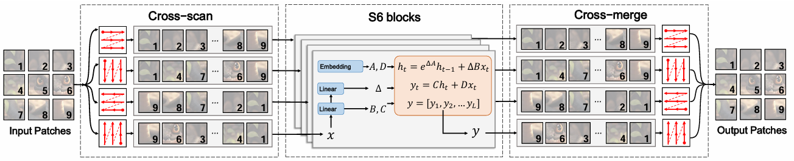
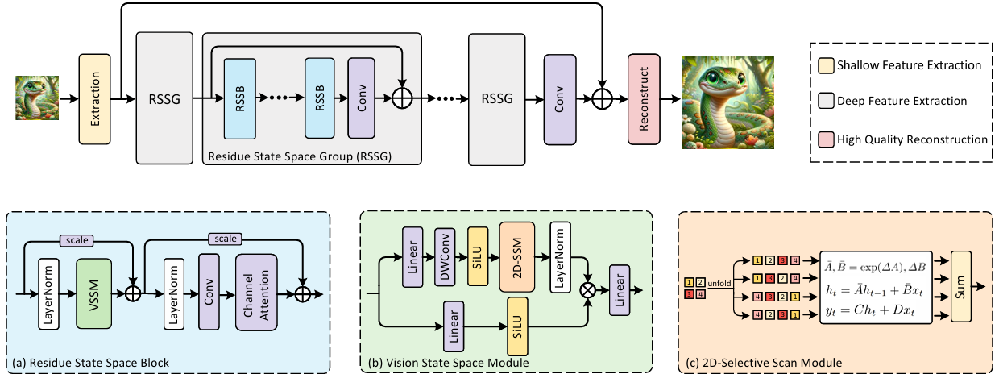
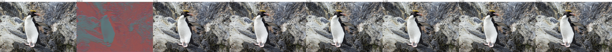

# Mamba-based Image Super-Resolution

[English](README.md) | [中文](README.zh-CN.md)

**One sentence:** reproduce MambaIR (ECCV 2024) and MaIR (CVPR 2025) under one matched
×4 training budget, show that three of MambaIR's four scan directions carry almost no
information, and then put back the local operator that MaIR removed along the way — a
CNN-SSM fusion module called **CSBlock**, worth +0.27 dB, concentrated on regular
texture, for +126% parameters.

## 1. Overview

Single-image super-resolution (SR) reconstructs a high-resolution image from one
low-resolution observation. It is an ill-posed inverse problem: many HR images are
consistent with the same LR input, so the job is to learn a prior over natural image
structure that picks the right one.

The architectural question this repository works on is which sequence model should
carry that prior. Transformers model the whole image with pairwise attention at
O(N²); recurrent models are linear but bounded by a fixed hidden state. State-space
models (SSM) — Mamba in particular — claim both: a selective recurrence whose state
is compressed from the whole prefix, at O(N) cost.

That claim is where the interesting failure is. SSMs are defined on **1D sequences**,
and an image is not one. Every Mamba-based restoration model therefore has to answer
the same question — *how do you serialize a 2D image without destroying the 2D
neighbourhood structure the convolution it replaced used to get for free* — and the
answer each model gives is the thing that separates it from the others.

This repository follows that thread through two stages:

| Stage | Question | Folder |
|---|---|---|
| 1 | Does MambaIR's four-direction Cross-Scan actually give four directions of information? | [`mambair/`](mambair/) |
| 2 | MaIR fixed the scan but dropped every convolution doing it. What does that cost? | [`mair-cnn-ssm/`](mair-cnn-ssm/) |

Every model here was trained on the same terms — DIV2K (800 images), 128×128 patches,
batch size 96, 25,000 iterations, one RTX 4090 — so the three rows of the main table are
directly comparable to each other, and only to each other. The papers' own numbers come
from DF2K with 500K iterations and sit 0.24–0.89 dB higher.

### Repository layout

```
mamba-image-super-resolution/
├── README.md                              # this file
├── README.zh-CN.md
├── mambair/                               # stage 1 — MambaIR + scan ablation
│   ├── README.md, README.zh-CN.md
│   ├── report.pdf                         # 13 pages
│   ├── code/                              # mambair_arch.py, train.py, test.py, config
│   ├── figures/                           # architecture, cross-scan, SSM, complexity, progression
│   └── logs/                              # 1 training + 1 benchmark run, 25K iterations
└── mair-cnn-ssm/                          # stage 2 — MaIR + CSBlock
    ├── README.md, README.zh-CN.md
    ├── report.pdf                         # 14 pages
    ├── code/                              # mair_arch.py, original, train.py, test.py
    ├── yaml/                              # 4 configs: MaIR-S and MaIR-CSB, train + test
    ├── figures/                           # architecture, CSBlock, curve, 5 four-panel crops
    └── logs/                              # 3 training + 2 benchmark runs
```

## 2. Key Features / Contributions

**1. A scan-direction ablation that isolates Cross-Scan's redundancy.** Inference-only,
on frozen weights, changing nothing but how many directions `forward_core` sums.
Dropping from four directions to one costs **0.10 dB on average** across Set5 / Set14 /
B100 / Urban100. If the four scans were four independent views, a 75% reduction should
hurt far more than that. It does not, and §4.3 argues why.

**2. A matched-budget reproduction of MaIR.** NSS (a nested S-shaped scan path) plus SSA
(sequence shuffle attention) beats MambaIR by **+1.61 dB** under identical compute —
by a wide margin the largest effect measured here. It also converges faster: 29 dB in
~4,000 iterations, which MambaIR does not reach in 25,000.

**3. CSBlock — a CNN-SSM fusion module (46 lines).** A small CNN runs *in parallel with
the VMM inside the same block*, reading the block's original input rather than the SSM
output, so the local branch sees the unprocessed signal instead of trying to recover it
afterwards. **+0.27 dB average, 4-of-4 wins, +0.42 dB on Urban100.**

**4. A corrected parameter accounting.** The accompanying report states CSBlock adds
"only 5.5% parameters". It adds **+126%** — the network more than doubles. §4.5 shows
where the 5.5% came from and why it is off by a factor of 24.

**What is *not* a contribution.** Everything else in this repository is upstream. The
BasicSR fork, `train.py`, `test.py`, `mambair_arch.py`, and all of `mair_arch.py` except
the `MSS_VMM` class are third-party code, reproduced here under its original licences.
See the per-file table in §3.4.

## 3. Methodology / Architecture

### 3.1 The problem is the serialization, not the model


An SSM carries a hidden state `h(t) = A·h(t-1) + B·x(t)` and emits `y(t) = C·h(t)`.
That is O(N) and stores the whole prefix in one state — the reason it can compete with
attention at all. But flattening a 2D grid into a 1D sequence is exactly where the
trouble starts: pixels that are vertical neighbours on the grid land far apart in the
sequence (the orange pair above), and a recurrence whose state has to cross all the
tokens between them has to spend capacity remembering a distance rather than a
structure.

Every model in this repository is a different answer to that one question.

### 3.2 MambaIR and Cross-Scan



MambaIR's answer is to scan the feature map **four times** — along rows, columns, and
both diagonals — and sum the four results element-wise. That sum is a single line at
`mambair_arch.py:379-381`, which is what makes the ablation in §2.1 a clean isolation of
the scan rather than of the training.



The model is a SwinIR-style three-stage backbone — shallow feature extraction, a stack of
Residual State Space Groups, and a reconstruction head — with the transformer block
replaced by RSSB, and self-attention replaced by the VSSM above.

### 3.3 MaIR: NSS and SSA


MaIR answers the serialization question directly instead of patching it. **NSS** is a
single nested S-shaped path: the image is cut into horizontal strips, each strip is
walked in a boustrophedon, and the folds shrink the 1D distance between vertically
adjacent pixels from *W* to 2. One scan, whole feature map, both directions of
neighbourhood preserved. **SSA** then handles fusion by shuffling channels into groups,
scoring them, and gating — replacing MambaIR's blind sum with something learnable.

The price is visible in the diagram: MaIR's residual block is `LayerNorm → VMM →
LayerNorm → MLP`. With CAB gone, the deep feature path contains **no convolution at
all**.

### 3.4 CSBlock: CNN-SSM fusion


Losing every convolution is what CSBlock addresses. The module runs the SSM stream and a
convolutional stream **side by side inside one block**, both fed the block's original
input, and fuses the two by channel concatenation and a linear projection:

| Component | Detail |
|---|---|
| SSM stream | the upstream VMM, unchanged — the SS2D kernel is not touched |
| CNN stream | two full 3×3 convolutions (`padding=1`, so no resolution change), SiLU after each |
| Fusion | concatenate along channels (2C), `Linear(2C → C)`, `LayerNorm` |

*CSBlock is the module; CNN-SSM is the fusion scheme it implements.* The class is
`MSS_VMM`, the config that enables it is `MaIR_MSS`, and the logs tag the resulting
model MaIR-CSB — four strings for one thing, because the module was named after the
method was.

Two details carry the design. The CNN branch reads the block's **input**, not the SSM
output, so it is a genuinely parallel stream rather than a residual correction on top of
the SSM. And the convolutions are full 3×3 (`groups=1`), not depthwise, so they mix
channels as well as space. Full source: [`mair-cnn-ssm/code/mair_arch.py`](mair-cnn-ssm/code/mair_arch.py)
(the `MSS_VMM` class), with [`mair_arch_original.py`](mair-cnn-ssm/code/mair_arch_original.py)
alongside for diffing.

It is swapped in for `VMM` in one line of `RMB.__init__`. Against the upstream file it is
**46 added lines and 1 changed line**; `mair_arch_original.py` is kept alongside so the
diff can be read directly.

| File | Status |
|---|---|
| `mair-cnn-ssm/code/mair_arch.py` | **Mine.** `MSS_VMM` (the CSBlock) added, `RMB` switched to use it. 46 lines. |
| `mair-cnn-ssm/code/mair_arch_original.py` | Upstream MaIR, kept verbatim for diffing. |
| `mambair/code/mambair_arch.py` | Upstream MambaIR, unmodified. |
| `*/code/train.py`, `*/code/test.py` | Upstream BasicSR entry points, unmodified. |
| `mair-cnn-ssm/yaml/*` | Upstream configs with the hyperparameters in §4.1. |
| `*/report.pdf` | The two written reports: literature review, method, experiments, error analysis. |
| `*/logs/*` | Raw BasicSR stdout from the runs the tables are built from. |
| `*/figures/*` | Figures from the reports. The mechanism and architecture diagrams in §3.1–3.3 are third-party figures reproduced from the MambaIR, MaIR and VMamba papers; the training curves, SR panels and training-progression strip are from these runs. |

`train.py`, `test.py` and the architecture files other than `mair_arch.py` come from the
[BasicSR](https://github.com/XPixelGroup/BasicSR), [MambaIR](https://github.com/csguoh/MambaIR)
and [MaIR](https://github.com/csguoh/MaIR) codebases. The training configs are the upstream
lightSR configs with a smaller `gt_size` and fewer iterations. Those projects' licences
apply to their files, not to this repository as a whole.

## 4. Experiments and Results

### 4.1 Setup

All runs: DIV2K train (800 images), ×4 bicubic degradation, `gt_size=128`,
`batch_size_per_gpu=96`, `total_iter=25000`, Adam (`lr=2e-4`, `weight_decay=0`),
`embed_dim=60`, seed 10, single RTX 4090, no horizontal flip or rotation augmentation.
Evaluation is Y-channel PSNR / SSIM with `crop_border=4` on Set5, Set14, B100 and
Urban100.

The three models came from two different environments (the reproduction spans two
upstream forks, which pin different BasicSR versions) — see §5.

### 4.2 Main results

| Test set | MambaIR (repro) | MaIR (repro) | + CSBlock | MaIR (paper) | CSBlock gap to paper |
|---|:---:|:---:|:---:|:---:|:---:|
| Set5 | 29.29 / 0.837 | 31.64 / 0.886 | **31.98 / 0.891** | 32.48 / 0.899 | −0.50 |
| Set14 | 26.73 / 0.723 | 28.22 / 0.773 | **28.42 / 0.778** | 28.81 / 0.786 | −0.39 |
| B100 | 26.30 / 0.679 | 27.34 / 0.729 | **27.47 / 0.733** | 27.71 / 0.741 | −0.24 |
| Urban100 | 23.74 / 0.689 | 25.29 / 0.761 | **25.71 / 0.775** | 26.60 / 0.801 | −0.89 |
| **Average** | 26.52 | 28.12 | **28.40** | 28.90 | −0.50 |

The gains are not uniform, and the ordering is the interesting part:

| | Set5 | Set14 | B100 | Urban100 | avg |
|---|:---:|:---:|:---:|:---:|:---:|
| MambaIR → MaIR | +2.35 | +1.49 | +1.04 | +1.55 | **+1.61** |
| MaIR → +CSBlock | +0.34 | +0.20 | +0.13 | **+0.42** | **+0.27** |

### 4.3 Where the CSBlock gain comes from

Urban100 — regular architecture and repeating structure: brickwork, railings, window
grids — gains 3× what B100's natural stochastic texture does. That is what the design
predicts: a 3×3 kernel's receptive field is the right size for a periodic pattern whose
period is a few pixels, and the wrong size for global statistics. It is a consistent
4-of-4 win with no regression anywhere, which is the main thing the table is there to
show.

Convergence says the same thing from another angle: CSBlock breaks 30 dB around
iteration 10,000 where MaIR takes ~22,000 — roughly a 2× early-training speedup, which
narrows to a stable ≈0.26 dB once the SSM branch has converged.



*The same crop across training: LR bicubic, random initialisation, then 2.5K / 5K / 10K /
15K / 25K iterations.*

The ablation in §2.1 points the same way. Three of Cross-Scan's four directions turn out
to be near-duplicates of each other, which is only surprising until you notice that 1D
flattening has already destroyed 2D continuity *before* scanning begins — so re-flattening
in another order does not restore what was lost. MambaIR bought four scans and got one
direction's worth of information; MaIR's single NSS path is the direct consequence.

### 4.4 Visual comparison

`LR (bicubic) | MaIR | MaIR + CSBlock | GT`, one crop per benchmark dataset, native
resolution — the visual evidence for the +0.13…+0.42 dB spread.

| Set5 | Set14 |
|---|---|
|  |  |

| B100 | Urban100 |
|---|---|
|  |  |

### 4.5 Parameter accounting

Measured from the training logs, which print the real counts:

| | Params |
|---|---:|
| MambaIR-Light (repro) | 924,492 |
| MaIR-S-Light | 1,374,156 |
| MaIR + CSBlock (MaIR-CSB) | 3,109,356 |
| **MaIR-S → MaIR-CSB** | **+1,735,200 (+126%)** |

Per block: 2 × 3×3 conv (2 × 32,460) + fusion `Linear(2C, C)` (7,260) + `LayerNorm` (120)
= **72,300**, × 24 blocks = 1,735,200 — exactly the difference the logs report.

> **A note on the 5.5% figure.** The accompanying report states that CSBlock adds "only
> 5.5% parameters", and the architecture diagram in §3.4 carries the same claim. That
> number is one block's 72,300 measured against the *whole* base model (72,300 ÷
> 1,374,156 ≈ 5.3%), and it is correct only in that per-block sense. The model-level
> increase is **+126%** — the network more than doubles in size. The +0.27 dB is real and
> the CSBlock design stands on its own, but the efficiency framing in the report is off
> by a factor of 24, and this table is the corrected version.

So the honest summary is: **+0.27 dB for +126% parameters, with the gain concentrated in
regular texture.** As a paper-style contribution that is a poor trade. As a study of
*where* a pure-SSM backbone is still weak — local, periodic structure — it is a clear
signal, and the per-dataset ordering confirms the mechanism rather than just the number.

## 5. Tech Stack

| | Stage 1 (`mambair/`) | Stage 2 (`mair-cnn-ssm/`) |
|---|---|---|
| OS | Ubuntu 22.04 | Ubuntu 22.04 |
| GPU | RTX 4090 (49 GB with VRAM expansion) | RTX 4090 |
| Python | 3.10 | 3.10 |
| PyTorch | 2.1.0+cu121 | 2.4.0+cu121 |
| TorchVision | 0.16.0+cu121 | 0.19.0+cu121 |
| CUDA | 12.1 | 12.1 |
| BasicSR | 1.3.5 (bundled in the MambaIR fork) | 1.2.0+0051603 (bundled in the MaIR fork) |
| Kernel | `mamba-ssm` 1.1.1 + `causal-conv1d` 1.1.1, built with `nvcc` | same |

The two stages are separate environments because they follow two different upstream
forks, and those forks pin different BasicSR versions. Nothing is shared at runtime
between them; each folder reproduces its own stage end to end.

## 6. Installation and Usage

Neither stage ships a complete runnable tree — what is here is the subset of files that
differs from upstream. To run either one, clone the corresponding upstream repository
and drop these files in.

### Stage 1 — MambaIR

```bash
git clone https://github.com/csguoh/MambaIR.git
cd MambaIR
pip install -r requirements.txt          # needs nvcc for the mamba-ssm build
pip install mamba-ssm==1.1.1 causal-conv1d==1.1.1

# copy the files from this repo's mambair/ over the upstream tree
cp <this-repo>/mambair/code/mambair_arch.py   basicsr/archs/
cp <this-repo>/mambair/code/train.py          basicsr/train.py
cp <this-repo>/mambair/code/test.py           basicsr/test.py

python -m basicsr.train -opt <this-repo>/mambair/code/train_MambaIR_lightSR_x4_my.yml
python -m basicsr.test  -opt <this-repo>/mambair/code/test_MambaIR_lightSR_x4_my.yml
```

### Stage 2 — MaIR

```bash
git clone https://github.com/csguoh/MaIR.git
cd MaIR
pip install -r requirements.txt
pip install mamba-ssm==1.1.1 causal-conv1d==1.1.1

cp <this-repo>/mair-cnn-ssm/code/mair_arch.py basicsr/archs/mair_arch.py

# MaIR-CSB: the CSBlock variant
python -m basicsr.train -opt <this-repo>/mair-cnn-ssm/yaml/train_MaIR_MSS_lightSR_x4.yml
python -m basicsr.test  -opt <this-repo>/mair-cnn-ssm/yaml/test_MaIR_MSS_lightSR_x4.yml

# MaIR-S baseline: swap in the unmodified architecture file first
cp <this-repo>/mair-cnn-ssm/code/mair_arch_original.py basicsr/archs/mair_arch.py
python -m basicsr.train -opt <this-repo>/mair-cnn-ssm/yaml/train_MaIR_S_lightSR_x4_my.yml
```

**The configs need editing.** They point at the original machine's `/root/autodl-tmp/...`
paths for datasets and checkpoints — 12 files across the two stages carry those absolute
paths. Change `dataroot_gt`, `dataroot_lq` and the test sets before running.

No model checkpoints are included: 25K-iteration weights are ~15 MB each, and the logs
plus figures here are the record of the runs.

## 7. Limitations

- **One configuration only.** Light variants, DIV2K, ×4. Nothing here says what CSBlock
  does on a larger model, on DF2K, or on denoising and deblurring.
- **Absolute PSNR is not comparable to the papers.** 25K iterations on 800 images versus
  500K on 3,450. The comparisons that mean anything are the ones between rows of the same
  table.
- **The CSBlock design was chosen by hand** — two 3×3 convolutions, channel concatenation,
  linear fusion. No search over that space was done, and the alternatives were not tried.
- **"Regular texture" is a qualitative label here.** The Urban100 > Set5 > Set14 > B100
  ordering is consistent and matches the hypothesis, but no texture-complexity metric was
  computed to predict the gain, so the mechanism is argued rather than measured.
- **+126% parameters is a large price** for +0.27 dB, as noted in §4.5. CSBlock is a
  diagnostic instrument first and a competitive model second.
- **The scan ablation is inference-only.** It reuses one trained checkpoint and varies the
  forward pass, which isolates the mechanism cleanly but says nothing about what a
  four-direction model would learn if trained that way.
- **Two environments, two forks.** See §5. A single-environment reproduction would be
  cleaner; this one is what the runs actually used.

## References

- Guo et al. **MambaIR: A Simple Baseline for Image Restoration with State-Space Model.** ECCV 2024.
- Li et al. **MaIR: A Locality- and Continuity-Preserving Mamba for Image Restoration.** CVPR 2025.
  ([arXiv:2412.20066](https://arxiv.org/abs/2412.20066))
- Liu et al. **VMamba: Visual State Space Model.** NeurIPS 2024.
- Liang et al. **SwinIR: Image Restoration Using Swin Transformer.** ICCVW 2021.
- Gu & Dao. **Mamba: Linear-Time Sequence Modeling with Selective State Spaces.** 2023.
