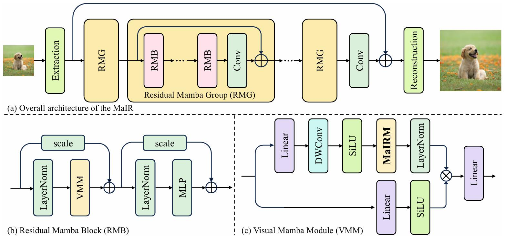
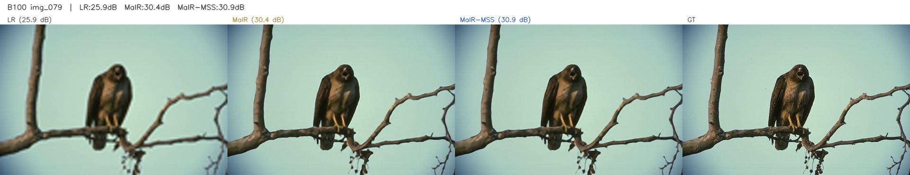
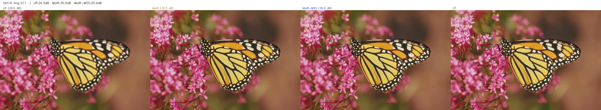
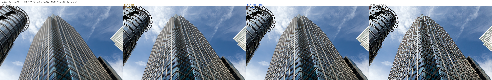

# MaIR + CSBlock: A CNN-SSM Fusion Module

**Putting the local operator back inside the block the pure-SSM backbone removed it from**

[English](README.md) | [中文](README.zh-CN.md) | [← Repository root](../README.md)

> Stage two of this repository. Full report: [`report.pdf`](report.pdf) (14 pages). Stage one — the MambaIR reproduction and scan-direction ablation — is in [`../mambair/`](../mambair/).

<p align="center">
  
  <br><em>CSBlock: a small CNN running in parallel with the VMM inside the same residual block. Note that the CNN branch's arrow comes straight from the input on the far left and never passes through the VMM — that is the whole meaning of the word "parallel". The +72K in the lower right is the per-block cost; 24 blocks come to +1.735M, i.e. +126% at the model level, see §4.3.</em>
</p>

---

## 1. Background

Stage one measured that three of MambaIR's four Cross-Scan directions are near-redundant with each other, with the root cause being that 1D flattening destroys 2D continuity **before** scanning begins — and re-flattening in a different order cannot get it back. [MaIR](https://github.com/csguoh/MaIR) (CVPR 2025) takes that diagnosis and answers it head-on: **NSS** (a nested S-shaped scan) replaces the four independent straight lines with a single nested S-shaped path — the image is cut into non-overlapping horizontal strips, each strip is traversed in a boustrophedon fold, and the folds shrink the 1D distance between vertically adjacent pixels from *W* to **2**, preserving both directions of neighbourhood in one scan; **SSA** replaces MambaIR's blind element-wise sum with a learnable channel gate. Under identical training conditions that is worth **+1.61 dB**, by a wide margin the largest effect measured in this repository.

The price is visible in the architecture diagram. MaIR's residual block is `LayerNorm → VMM → LayerNorm → MLP`, and with CAB gone the **deep feature path contains no convolution at all**. That is a deliberate choice — building a purely SSM vision model — but it also means the network has to express local, high-frequency texture through a mechanism whose inductive bias is *global*. The question then becomes concrete: **how large is that cost, and can it be quantified with the smallest possible change?**

<p align="center">
  
  <br><em>(a) The three-stage backbone — shallow feature extraction, residual Mamba groups, reconstruction. (b) RMB: LayerNorm → VMM → LayerNorm → MLP. That last step is an MLP rather than CAB, and that is where the convolution disappears. (c) The VMM, with NSS inside it. Source: MaIR paper Fig. 2.</em>
</p>

CSBlock is one such hypothesis — "the absence of convolution is why MaIR is limited on regular texture" — plus the minimal change that tests it. The test is direct: put the local operator back and see where the gain lands. If the hypothesis holds, the gain should scale with how much local periodic structure an image contains, rather than being a uniform background improvement. **That is exactly what happens: Urban100 (regular architecture and repeating structure) gains 3× what B100 (natural stochastic texture) does, 4-of-4 wins, no regression anywhere.** A consistent ordering, a single direction, and no regressions together rule out both "the gain is noise" and "the gain is just a side effect of having more parameters".

Three design constraints keep the test as clean as possible. **Parallel, not sequential**: both streams read the same block's original input, with neither feeding the other, so the local branch sees the unprocessed signal instead of being brought in to patch things up after the SSM has smoothed it over — which is why this is described as *intra-block* rather than a post-hoc fix. **Full 3×3, not depthwise**: depthwise would cut the cost by another ~32×, but it does not mix channels, and channel mixing is part of what the local operator is being asked to do here. **The VMM is left untouched**: CSBlock only ever adds beside the SSM, so no regression can be attributed to the scan having been changed. In code this is **46 added lines and 1 changed line** against upstream, one class replacing another class.

The result: CSBlock averages **+0.27 dB**, winning on all four benchmarks with no regression; it converges roughly 2× faster in early training, breaking 30 dB around iteration 10,000 where MaIR takes ~22,000, and the gap narrows to a stable ≈0.26 dB once the SSM branch has converged. The cost is **+126% parameters** — the network more than doubles. As a paper-style contribution that is a poor trade; what it does establish is something narrower and more useful — it locates a specific weakness of pure-SSM vision backbones, shows that a 3×3 receptive field is enough to address it, and demonstrates that the effect is largest exactly where theory predicts.

---

## 2. Key Features / Contributions

1. **A matched-budget reproduction of MaIR.** MaIR-S-Light ×4, 25,000 iterations on DIV2K, 1,374,156 parameters — every hyperparameter identical to stage one's MambaIR run, so the +1.61 dB is measured with the same yardstick rather than subtracted from two paper numbers.

2. **CSBlock — a CNN-SSM fusion module in 46 lines.** A small CNN **in parallel with the VMM inside the same residual block**. Both streams receive the block's **original input**, and the two outputs are concatenated along channels and fused by a linear projection.

3. **The gain lands exactly where the design predicts.** **+0.27 dB on average, 4-of-4 wins, no regression anywhere.** Urban100 (+0.42) gains 3× what B100 (+0.13) does. Early-stage convergence is roughly 2× faster as well.

4. **A corrected parameter accounting.** CSBlock's model-level cost is **+126%**, not a rounding error. It is called out separately because it decides how the module should be positioned — a diagnostic instrument, not a bargain.

Final results (×4, Y-channel PSNR / SSIM):

| Test set | MambaIR (repro) | MaIR (repro) | MaIR + CSBlock | MaIR (paper) | CSBlock gap to paper |
|---|:---:|:---:|:---:|:---:|:---:|
| Set5 | 29.29 / 0.837 | 31.64 / 0.886 | **31.98 / 0.891** | 32.48 / 0.899 | −0.50 |
| Set14 | 26.73 / 0.723 | 28.22 / 0.773 | **28.42 / 0.778** | 28.81 / 0.786 | −0.39 |
| B100 | 26.30 / 0.679 | 27.34 / 0.729 | **27.47 / 0.733** | 27.71 / 0.741 | −0.24 |
| Urban100 | 23.74 / 0.689 | 25.29 / 0.761 | **25.71 / 0.775** | 26.60 / 0.801 | −0.89 |
| **Average** | 26.52 | 28.12 | **28.40** | 28.90 | −0.50 |

The gain decomposed across the two stages:

| | Set5 | Set14 | B100 | Urban100 | avg |
|---|:---:|:---:|:---:|:---:|:---:|
| Scan path, MambaIR → MaIR | +2.35 | +1.49 | +1.04 | +1.55 | **+1.61** |
| Local operator, MaIR → +CSBlock | +0.34 | +0.20 | +0.13 | **+0.42** | **+0.27** |

The paper column comes from DF2K (3,450 images) run for 500K iterations; this repository runs DIV2K (800 images) for 25K — that 0.24–0.89 dB gap is a training-budget gap, not a failed reproduction. Raw logs: [`logs/`](logs/).

**What is *not* a contribution.** Everything in `mair_arch.py` except the `MSS_VMM` class, along with `train.py`, `test.py` and the four YAML configs, is upstream MaIR / BasicSR code. The original work here really is that 46-line diff. Per-file list at the end of this document, under [Repository layout](#repository-layout).

---

## 3. Methodology / Architecture

### 3.1 Base architecture: MaIR

MaIR keeps the SwinIR-style three-stage backbone from stage one — shallow feature extraction, residual Mamba groups, reconstruction head — and rewrites the inside of the residual block. The contrast with MambaIR is worth laying out:

| | MambaIR | MaIR |
|---|---|---|
| Scan path | Cross-Scan: 4 independent straight lines | NSS: one nested S-shaped path |
| Vertical continuity | compensated by extra scans | preserved by the folds (1D distance → 2) |
| SSM calls | 4 per block | 1 per block |
| Fusion | element-wise sum of four directions | single path, nothing to fuse |
| Attention | none | SSA channel-shuffle gating |
| Feed-forward | CAB (Conv2d + channel attention) | **MLP (purely linear)** |

That last row is the entry point. MambaIR's feed-forward block contains a convolution; MaIR replaces it with a linear MLP, and in doing so removes the last local operator on the deep path. The figure at the top of this page is the full structure from MaIR paper Fig. 2.

### 3.2 CSBlock

The figure at the top of this page is it. Losing every convolution is what CSBlock addresses — the module runs the SSM stream and a convolutional stream side by side inside one block, both fed the same original input:

| Component | Detail |
|---|---|
| SSM stream | the upstream VMM, unchanged — `in_proj → permute + Conv1d + SiLU → NSS scan + selective scan → chunk/sum/gate → out_norm + gate(z) + out_proj`, with the SS2D kernel untouched |
| CNN stream | `permute → BCHW → Conv3×3 + SiLU → Conv3×3 + SiLU → permute → BHWC`, `padding=1`, so no resolution change |
| Fusion | concatenate along channels (`2C`) → `Linear(2C → C)` → `LayerNorm` |

In code this is a class called `MSS_VMM` at `mair_arch.py:346`, made of three parts: the upstream `VMM`, a two-layer `nn.Sequential` convolutional stream, and a `Linear(2C → C)` plus `LayerNorm` fusion head. It is swapped in for `VMM` in one line of `RMB.__init__`, and against upstream it is **46 added lines and 1 changed line**. Full source: [`code/mair_arch.py`](code/mair_arch.py), with [`mair_arch_original.py`](code/mair_arch_original.py) kept verbatim alongside it so the diff can be read directly:

```bash
diff mair-cnn-ssm/code/mair_arch_original.py mair-cnn-ssm/code/mair_arch.py
```

*CSBlock is the module; CNN-SSM is the fusion scheme it implements.* The class is `MSS_VMM`, the config that enables it is `MaIR_MSS`, and the logs tag the resulting model MaIR-CSB — four strings for one thing, because the module was named after the method was.

### 3.3 Experiment roadmap

| Stage | Question | Variants | Conclusion |
|---|---|---|---|
| 1 | Do Cross-Scan's four directions really each carry information? | 4-dir / 2-dir / 1-dir (see [`../mambair/`](../mambair/)) | dropping to one direction costs 0.10 dB; three are echoes |
| 2 | What is the absence of a local operator worth? | MaIR-S / MaIR-CSB | +0.27 dB for +126% parameters, gain concentrated in regular texture (§4.2, §4.3) |

---

## 4. Experiments and Results

### 4.1 Setup

**Data.** DIV2K train (800 images), ×4 bicubic degradation, `gt_size = 128`. Evaluation on the Set5, Set14, B100 and Urban100 benchmarks.

**Models.** MaIR-S-Light (1,374,156 parameters) and MaIR-CSB (3,109,356), `embed_dim = 60`, configured identically except for whether CSBlock is inserted.

**Training.** 25,000 iterations, Adam (`lr = 2e-4`, `weight_decay = 0`), `batch_size_per_gpu = 96`, seed 10, a single RTX 4090. Horizontal flips and rotations are off — consistent with stage one, but again dropping a regulariser the upstream configs use.

**Metrics.** Y-channel PSNR / SSIM with `crop_border = 4`. Raw logs in [`logs/`](logs/).

The baseline was trained in two passes: the first was interrupted at about 24,400 steps and the second resumed from the 22,500-step checkpoint — hence two `train_MaIR_S_*` logs but only one `test_MaIR_S_*`.

### 4.2 Where the gain comes from

In the gain decomposition table in §2, the ordering is the argument. Urban100 is a corpus of regular architecture — brickwork, railings, window grids, repeating façades; B100 is natural stochastic texture. If CSBlock works by putting back a local operator, its gain should scale with how much local periodic structure an image contains — and it does: **Urban100 gains 3.2× what B100 does**. A 4-of-4 win with no regression anywhere rules out the gain being noise.

<p align="center">
  
  <br><em>Convergence says the same thing: CSBlock breaks 30 dB around iteration 10,000 where MaIR takes ~22,000 — roughly a 2× early-training speedup — and the gap narrows to a stable ≈0.26 dB once the SSM branch has converged.</em>
</p>

A local operator appears to be cheap to fit early and worth less once the global model catches up; that remaining 0.26 dB is its value at equilibrium.

### 4.3 Parameter accounting

The numbers come from the real values BasicSR prints in the training logs:

```
INFO: Network: MaIR, with parameters: 1,374,156     # MaIR-S baseline
INFO: Network: MaIR, with parameters: 3,109,356     # with CSBlock
```

| | Params |
|---|---:|
| MaIR-S-Light | 1,374,156 |
| MaIR + CSBlock (MaIR-CSB) | 3,109,356 |
| **Difference** | **+1,735,200 (+126%)** |

Per block: 2 × 3×3 conv (2 × 32,460) + fusion `Linear(2C, C)` (7,260) + `LayerNorm` (120) = **72,300**, × 24 blocks = 1,735,200 — exactly the difference the logs report, which confirms both the per-block figure and the block count.

The "5.5%" in the report and in the lower right of the architecture diagram is the **per-block** 72,300 measured against the **whole** base model (72,300 ÷ 1,374,156 ≈ 5.3%), and it describes "each block adds this little" rather than the growth of the model. At the model level the figure is **+126%** — a factor of 24 apart.

So the conclusion is: **+0.27 dB for +126% parameters, with the gain concentrated in regular texture.** As a paper-style contribution that is a poor trade. CSBlock is a diagnostic instrument first and a competitive model second.

### 4.4 Visual comparison

`LR (bicubic) | MaIR | MaIR + CSBlock | GT`, one crop per benchmark, at native resolution — the visual evidence for the +0.13…+0.42 dB spread in §2. These images are deliberately uncompressed: their job is to show pixel-level texture differences, and resampling would defeat it.

<p align="center">
  
  <br><em>B100 img_079. Natural stochastic texture, the smallest gain of the four benchmarks (the dataset as a whole: +0.13).</em>
</p>

<p align="center">
  
  <br><em>Set14 img_011. Natural scenes, +0.20 overall.</em>
</p>

<p align="center">
  
  <br><em>Set5 img_002. Smooth regions dominate, +0.34 overall.</em>
</p>

<p align="center">
  
  <br><em>Urban100 img_043. Repeating structure on regular façades; this dataset is +0.42 overall, 3.2× B100.</em>
</p>

<p align="center">
  
  <br><em>Urban100 img_047, the second of the two Urban100 crops — where the +0.42 dB is easiest to see.</em>
</p>

---

## 5. Tech Stack

| | |
|---|---|
| OS | Ubuntu 22.04 |
| GPU | RTX 4090 |
| Python | 3.10 |
| PyTorch | 2.4.0+cu121 |
| TorchVision | 0.19.0+cu121 |
| CUDA | 12.1 |
| BasicSR | 1.2.0+0051603 (bundled in the MaIR fork) |
| Kernel | `mamba-ssm` 1.1.1 + `causal-conv1d` 1.1.1, built with `nvcc` |

Note that this is a **different environment** from [`../mambair/`](../mambair/) — that one follows the MambaIR fork and uses PyTorch 2.1.0 + BasicSR 1.3.5. The two stages share nothing at runtime and each reproduces its own stage end to end.

---

## 6. Installation and Usage

This directory is not a complete runnable project — it is the subset of files that differs from upstream. Start by cloning the upstream repository.

**1 — Set up the environment.**

```bash
git clone https://github.com/csguoh/MaIR.git
cd MaIR
pip install -r requirements.txt          # needs nvcc for the mamba-ssm build
pip install mamba-ssm==1.1.1 causal-conv1d==1.1.1
```

**2 — Drop in the architecture file.**

```bash
cp <this-repo>/mair-cnn-ssm/code/mair_arch.py basicsr/archs/mair_arch.py
```

**3 — Train and test MaIR-CSB (with CSBlock).**

```bash
python -m basicsr.train -opt <this-repo>/mair-cnn-ssm/yaml/train_MaIR_MSS_lightSR_x4.yml
python -m basicsr.test  -opt <this-repo>/mair-cnn-ssm/yaml/test_MaIR_MSS_lightSR_x4.yml
```

**4 — Train and test the MaIR-S baseline.** Swap back to the unmodified architecture file first:

```bash
cp <this-repo>/mair-cnn-ssm/code/mair_arch_original.py basicsr/archs/mair_arch.py
python -m basicsr.train -opt <this-repo>/mair-cnn-ssm/yaml/train_MaIR_S_lightSR_x4_my.yml
python -m basicsr.test  -opt <this-repo>/mair-cnn-ssm/yaml/test_MaIR_S_lightSR_x4_my.yml
```

Keeping both files is the whole point of reading that diff:

```bash
diff <this-repo>/mair-cnn-ssm/code/mair_arch_original.py \
     <this-repo>/mair-cnn-ssm/code/mair_arch.py
```

**5 — Edit the configs.** All four have to be changed. They point at the original machine's `/root/autodl-tmp/...` dataset paths and `/root/2025-CVPR-MaIR-main/experiments/...` checkpoint paths. Change `dataroot_gt`, `dataroot_lq`, the four test-set roots, `path.pretrain_network_g` and the results directory before running. Run from the root of the cloned upstream project — the relative experiment and results directories resolve against the working directory.

No model checkpoints are included: `net_g_25000.pth` is ~15 MB each, and the logs plus figures here are the record of the runs.

---

## 7. Limitations

- **One configuration only.** Light variants, DIV2K, ×4, 25K iterations. Nothing here says what CSBlock does on a larger model, on DF2K, or on denoising and deblurring.
- **The architecture was chosen by hand** — two 3×3 convolutions, channel concatenation, linear fusion. No search over that space was done, and depthwise, single-layer, attention-based fusion and a sequential rather than parallel placement were not tried.
- **+126% parameters is a large price** for +0.27 dB. The accounting in §4.3 is why this has to be said twice. CSBlock is a diagnostic instrument first.
- **"Regular texture" is a qualitative label here.** The Urban100 > Set5 > Set14 > B100 ordering is consistent and matches the hypothesis, but no texture-complexity metric was computed to predict the gain — the mechanism is argued from the ordering, not measured.
- **No placement ablation.** "Reads the input rather than the SSM output" is argued from the design; no variant reading the SSM output was run as a control. That is the most obvious next experiment.
- **Absolute PSNR is not comparable to the papers.** 25K iterations on 800 images versus 500K on 3,450; the −0.24…−0.89 dB gap to the paper's MaIR is a training-budget gap, not a failed reproduction.
- **SSIM is reported but not analysed separately.** It tracks PSNR closely, and no additional claim is made about it here.

---

## Repository layout

```
mair-cnn-ssm/                                     # stage two of mamba-image-super-resolution
├── README.md, README.zh-CN.md
├── report.pdf                                    # 14 pages
├── code/
│   ├── mair_arch.py                              # CSBlock (the MSS_VMM class) added
│   ├── mair_arch_original.py                     # upstream MaIR, kept for diffing
│   └── train.py, test.py                         # upstream BasicSR entry points, unmodified
├── yaml/
│   ├── train_MaIR_S_lightSR_x4_my.yml            # baseline, 25K iterations
│   ├── test_MaIR_S_lightSR_x4_my.yml
│   ├── train_MaIR_MSS_lightSR_x4.yml             # with CSBlock
│   └── test_MaIR_MSS_lightSR_x4.yml
├── figures/
│   ├── fig_mair_architecture.jpg                 # MaIR paper Fig. 2
│   ├── fig_csblock_architecture.png              # CSBlock: the two streams and the fusion
│   ├── fig_psnr_curve.png                        # training curves for both models
│   ├── B100_img_079_4panel.png                   # LR | MaIR | +CSBlock | GT
│   ├── Set14_img_011_4panel.png
│   ├── Set5_img_002_4panel.png
│   ├── Urban100_img_043_4panel.png
│   └── Urban100_img_047_4panel.png
└── logs/
    ├── train_MaIR_S_lightSR_x4_20260614_235037.log   # interrupted at ~24,400 steps
    ├── train_MaIR_S_lightSR_x4_20260615_140900.log   # resumed from 22,500
    ├── train_MaIR_MSS_lightSR_x4_20260615_192507.log
    ├── test_MaIR_S_lightSR_x4_20260615_145356.log
    └── test_MaIR_MSS_lightSR_x4_20260616_134215.log
```

Who wrote each of the files above:

| File | Status |
|---|---|
| `code/mair_arch.py` | **Mine.** Against upstream: **46 added lines, 1 changed line** — `MSS_VMM` (the CSBlock) added, `RMB` switched to use it. |
| `code/mair_arch_original.py` | Upstream MaIR, kept verbatim for diffing. |
| `code/train.py`, `code/test.py` | Upstream BasicSR entry points, unmodified. |
| `yaml/*` | Upstream lightSR configs with a smaller `gt_size` and fewer iterations. |
| `report.pdf` | The written report: literature review, method, experiments, error analysis. |
| `logs/*` | Raw BasicSR output; the tables in this document are built from it. |
| `figures/fig_mair_architecture.jpg` | Third-party figure reproduced from the MaIR paper, Fig. 2. |
| The other 7 in `figures/` | Produced by this run: the CSBlock diagram, the PSNR curve, and 5 four-panel crops. |

Upstream code comes from [MaIR](https://github.com/csguoh/MaIR) and [BasicSR](https://github.com/XPixelGroup/BasicSR), reproduced here under their original licences. Those projects' licences apply to their own files, not to this repository as a whole. Model checkpoints and datasets are not distributed with this repository.

---

## References

- Li et al. **MaIR: A Locality- and Continuity-Preserving Mamba for Image Restoration.** CVPR 2025.
  ([arXiv:2412.20066](https://arxiv.org/abs/2412.20066))
- Guo et al. **MambaIR: A Simple Baseline for Image Restoration with State-Space Model.** ECCV 2024.
  ([arXiv:2403.07764](https://arxiv.org/abs/2403.07764))
- Liu et al. **VMamba: Visual State Space Model.** NeurIPS 2024.
  ([arXiv:2401.10166](https://arxiv.org/abs/2401.10166))
- Liang et al. **SwinIR: Image Restoration Using Swin Transformer.** ICCVW 2021.
- Gu & Dao. **Mamba: Linear-Time Sequence Modeling with Selective State Spaces.** 2023.
