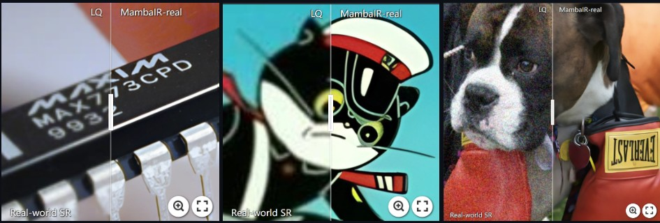
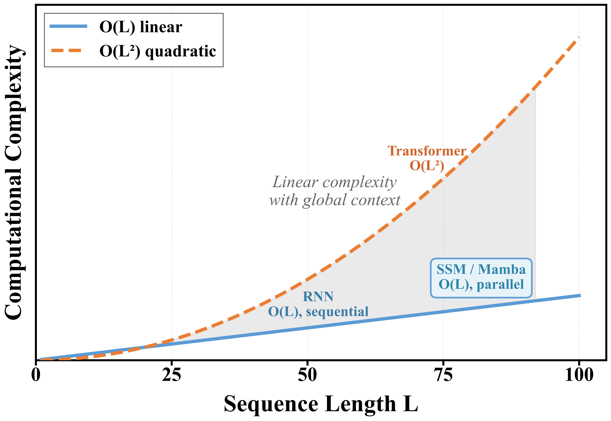

# MambaIR: reproduction and scan-direction ablation

[English](README.md) | [中文](README.zh-CN.md) | [← Repository root](../README.md)

**One sentence:** reproduce MambaIR's ×4 Light model on DIV2K under a fixed 25K-iteration
budget, then show — on frozen weights, changing nothing but how many directions the scan
sums — that three of Cross-Scan's four directions contribute **0.10 dB combined**.

## 1. Overview

[MambaIR](https://github.com/csguoh/MambaIR) (ECCV 2024) is the paper that put
state-space models into image restoration as a drop-in replacement for self-attention.
Its architecture is a SwinIR-style three-stage backbone — shallow feature extraction, a
stack of Residual State Space Groups, a reconstruction head — where each transformer
block is replaced by an RSSB and self-attention by a VSSM.

The reason that works at all is complexity. Attention is O(N²) in the number of pixels;
Mamba's selective recurrence is O(N) with a state that compresses the whole prefix. The
model gets a global receptive field at linear cost, which is exactly the trade a
high-resolution restoration task wants.

The reason it *doesn't* work cleanly is also complexity, in a different sense. A state
space model is defined on a **1D sequence**, and an image is a 2D grid. MambaIR's answer
is **Cross-Scan**: flatten the feature map along four different directions, scan each one
independently, and add the four results element-wise. The bet is that four linear
orderings approximate the 2D neighbourhood structure that the convolution they replaced
used to provide for free.

This folder reproduces the model and then tests that bet directly. It is the first of two
stages; the second is in [`../mair-cnn-ssm/`](../mair-cnn-ssm/), and the conclusions here
are what motivates it.



*What the task looks like on real captures rather than bicubic-degraded benchmarks:
`LQ | MambaIR` on three crops — the illustration the accompanying report opens with.*

### Folder layout

```
mambair/                                   # stage 1 of mamba-image-super-resolution
├── README.md, README.zh-CN.md
├── report.pdf                             # 13 pages
├── code/
│   ├── mambair_arch.py                    # upstream MambaIR, unmodified
│   ├── train.py                           # upstream BasicSR entry point
│   ├── test.py                            # upstream BasicSR entry point
│   └── train_MambaIR_lightSR_x4_my.yml    # the config this run used
├── figures/
│   ├── fig_mambair_architecture.png       # MambaIR paper Fig. 2
│   ├── fig_cross_scan_merge.png           # VMamba SS2D diagram
│   ├── fig_ssm_mechanism.jpg              # 2D→1D flattening, SSM recurrence
│   ├── fig_sr_comparison.jpg              # real-world SR illustration
│   ├── fig1_complexity.png                # O(N) vs O(N²)
│   └── training_progression.png           # one crop across 7 training stages
└── logs/
    ├── train_MambaIR_lightSR_x4_20260512_133105.log
    └── test_MambaIR_lightSR_x4_benchmark_20260512_194615.log
```

## 2. Key Features / Contributions

**1. A matched-budget reproduction.** MambaIR-Light ×4 trained on DIV2K to 25,000
iterations (924,492 parameters). Every hyperparameter is held identical to the second
stage's runs, so the two are comparable row-for-row.

**2. A scan-direction ablation.** Cross-Scan's four directions are summed by a single
line at `mambair_arch.py:379-381`. Reducing that sum to two directions, then to one, and
re-running inference is a clean isolation of the scan mechanism — no retraining, no
confound from what a differently-trained model might have learned.

**3. The finding.** Four directions → one costs **0.10 dB** averaged over Set5 / Set14 /
B100 / Urban100. §4.2 has the numbers and §4.3 argues the cause.

**What is not a contribution.** `mambair_arch.py`, `train.py` and `test.py` are upstream
MambaIR and BasicSR code, byte-identical to their repositories. The config is the upstream
lightSR config with a smaller `gt_size` and fewer iterations.

## 3. Methodology / Architecture

### 3.1 Why serializing a 2D image is the whole problem


An SSM maintains `h(t) = A·h(t-1) + B·x(t)` and emits `y(t) = C·h(t)`: O(N) cost, one
hidden state carrying the entire prefix, one pass over the sequence instead of the all-to-all
of attention (the right-hand table above).

Flattening a grid into that sequence is where the structure is lost. Pixels that are
vertical neighbours land far apart in the 1D order — the orange pair at the top of the
figure — and the recurrence has to spend state capacity representing that distance rather
than the relationship.


The full model: RSSG stacks with RSSB blocks (a), the VSSM that replaces self-attention
(b), and the 2D-selective-scan module inside it (c).

### 3.2 Cross-Scan


The VSS module takes the `H×W` feature map, flattens it four times — along rows, columns,
and both diagonals — runs an independent SSM over each 1D sequence, and folds the four
outputs back to 2D to sum them element-wise.

The design intent is that row scanning captures horizontal dependency, column scanning
captures vertical, and the diagonals cover the gaps, so the four together span every
neighbourhood relation on the grid. §4.3 tests that intent.

*Figure note: this Cross-Scan / S6 / Cross-Merge pipeline is the 2D-selective-scan
(SS2D) diagram from the VMamba paper, which is where the cross-scan scheme originates;
MambaIR adopts it wholesale in its VSSM. The MambaIR overview above is that paper's Fig.
2. Both are reproduced here as they appear in the report.*

## 4. Experiments and Results

### 4.1 Setup

DIV2K train (800 images), ×4 bicubic degradation, `gt_size=128`,
`batch_size_per_gpu=96`, `total_iter=25000` (~30 epochs), Adam (`lr=2e-4`,
`weight_decay=0`), `embed_dim=60`, seed 10. Horizontal flip and rotation augmentation
are off, which makes the run simpler to compare but removes a regulariser the upstream
config has. Evaluation is Y-channel PSNR / SSIM with `crop_border=4`.

### 4.2 The ablation

Inference-only, on one trained checkpoint, varying only how many directions
`forward_core` sums:

| Config | Directions | PSNR Set5 | Set14 | B100 | Urban100 | avg |
|---|---|:---:|:---:|:---:|:---:|:---:|
| 4-dir (MambaIR default) | forward + reverse + transpose + anti-transpose | 29.29 | 26.73 | 26.30 | 23.74 | 26.52 |
| 2-dir | forward + reverse | 29.19 | 26.71 | 26.27 | 23.70 | 26.47 |
| 1-dir | forward only | 29.13 | 26.66 | 26.23 | 23.65 | 26.42 |

| | Set5 | Set14 | B100 | Urban100 | avg |
|---|:---:|:---:|:---:|:---:|:---:|
| Δ 4 → 2 | −0.10 | −0.02 | −0.03 | −0.04 | **−0.05** |
| Δ 4 → 1 | −0.16 | −0.07 | −0.07 | −0.09 | **−0.10** |

Losing 75% of the scan directions costs 0.10 dB and 0.005 SSIM. If the four directions
were four independent views of the image, a 75% reduction should cost far more. It does
not.

### 4.3 Why


Three causes, in increasing order of importance:

**(1) The selective mechanism flattens direction differences.** Mamba's `B(x)`, `C(x)` and
`Δ(x)` are functions of the input, which is what separates it from a static SSM like S4.
Trained on the same content, the same content-filtering process runs over each of the four
orderings: the key reconstruction relationships concentrate in whichever direction
propagates best, and the others converge to approximations of it. Four directions are not
four specialists; they are one direction plus three echoes.

**(2) Element-wise addition has no way to discriminate.** `y = y1 + y2 + y3 + y4` weights
all four views equally. There is no gate, no learnable weight, no attention — the model
cannot learn to trust one direction over another, so it can only add them, and the sum of
near-identical sequences is close to a scalar multiple.

**(3) 1D flattening has already destroyed 2D continuity.** This is the root cause. In a
64×64 feature map, vertically adjacent pixels sit 64 tokens apart in row-major order, so
the state has to cross 64 irrelevant tokens to maintain the relationship. Scanning in
another order partially compensates, but compensation is all it is.

### 4.4 Training dynamics and reproduction quality

DIV2K validation PSNR starts at 10.61 dB at random initialisation and reaches 27.19 dB
within the first 2,500 iterations — 16.58 dB of movement in 10% of the run. That is the
implicit global modelling doing its job early: the coarse LR→HR mapping is established
almost immediately, and the remaining 22,500 iterations are worth 1.02 dB.



*Why the SSM backbone was chosen at all: O(N) versus attention's O(N²), with the gap
widening across the sequence lengths an HR image actually produces.*


*The same crop across training: LR bicubic, random initialisation, then 2.5K / 5K / 10K /
15K / 25K iterations.*

### 4.5 Parameter count

The training log prints the model as it is built:

```
INFO: Network: MambaIR, with parameters: 924,492
```

> **On the 1.3M figure.** The accompanying report states MambaIR-Light has about
> 1,303,401 parameters (≈1.3M) in six places. That is not what the run reports; the
> figure used here is the one the log prints. The likely source of 1.3M is the upstream
> MambaIR-S configuration rather than the Light variant this run actually built.

## 5. Tech Stack

| | |
|---|---|
| OS | Ubuntu 22.04 |
| GPU | RTX 4090 (49 GB with VRAM expansion) |
| Python | 3.10 |
| PyTorch | 2.1.0+cu121 |
| TorchVision | 0.16.0+cu121 |
| CUDA | 12.1 |
| BasicSR | 1.3.5 (bundled in the MambaIR fork) |
| Kernels | `mamba-ssm` 1.1.1 + `causal-conv1d` 1.1.1, built with `nvcc` |

Note this is a **different environment** from [`../mair-cnn-ssm/`](../mair-cnn-ssm/),
which follows the MaIR fork and runs PyTorch 2.4.0. The two stages share no runtime.

## 6. Installation and Usage

This folder is not a complete runnable tree — it is the subset of files that differs from
upstream. Clone the upstream repository first.

```bash
git clone https://github.com/csguoh/MambaIR.git
cd MambaIR
pip install -r requirements.txt          # needs nvcc for the mamba-ssm build
pip install mamba-ssm==1.1.1 causal-conv1d==1.1.1
```

Then drop these files in:

```bash
cp <this-repo>/mambair/code/mambair_arch.py   basicsr/archs/
cp <this-repo>/mambair/code/train.py          basicsr/train.py
cp <this-repo>/mambair/code/test.py           basicsr/test.py
```

### Train

```bash
python -m basicsr.train -opt <this-repo>/mambair/code/train_MambaIR_lightSR_x4_my.yml
```

### Test on the four benchmarks

```bash
python -m basicsr.test -opt <this-repo>/mambair/code/test_MambaIR_lightSR_x4_my.yml
```

**The config needs editing.** It points at the original machine's
`/root/autodl-tmp/datasets/DIV2K/...` paths. Change `dataroot_gt`, `dataroot_lq` and the
four test-set roots before running.

No checkpoints are included — 25K-iteration weights are ~15 MB, and the logs and figures
here are the record of the run.

## 7. Limitations

- **Inference-only ablation.** Clean isolation of the scan mechanism, but it says nothing
  about what a one-direction model would learn if trained that way. The comparison is
  between forward passes of one model, not between four models.
- **One configuration.** Light variant, DIV2K, ×4, 25K iterations. The redundancy finding
  is measured here and not shown to generalise to a larger model or a longer run.
- **No texture-complexity metric.** The claim that the residual error lives in regular
  high-frequency structure is read off the figures, not measured.
- **Absolute PSNR is not comparable to the paper.** 25K iterations on 800 images versus
  500K on 3,450; the paper's MambaIR-Light is well above these numbers.
- **Augmentation off.** Consistent with the second stage and with the training-progression
  figure, but it is a deviation from the upstream config and costs some generalisation.

## References

- Guo et al. **MambaIR: A Simple Baseline for Image Restoration with State-Space Model.** ECCV 2024.
  ([arXiv:2403.07764](https://arxiv.org/abs/2403.07764))
- Liu et al. **VMamba: Visual State Space Model.** NeurIPS 2024.
  ([arXiv:2401.10166](https://arxiv.org/abs/2401.10166))
- Liang et al. **SwinIR: Image Restoration Using Swin Transformer.** ICCVW 2021.
- Gu & Dao. **Mamba: Linear-Time Sequence Modeling with Selective State Spaces.** 2023.
